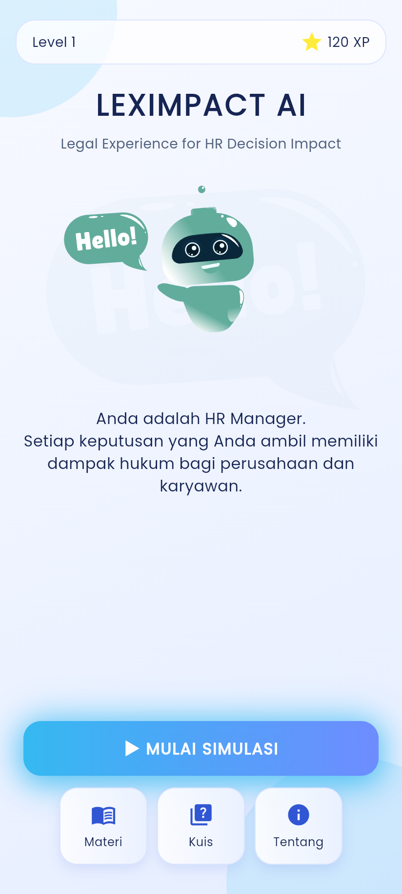
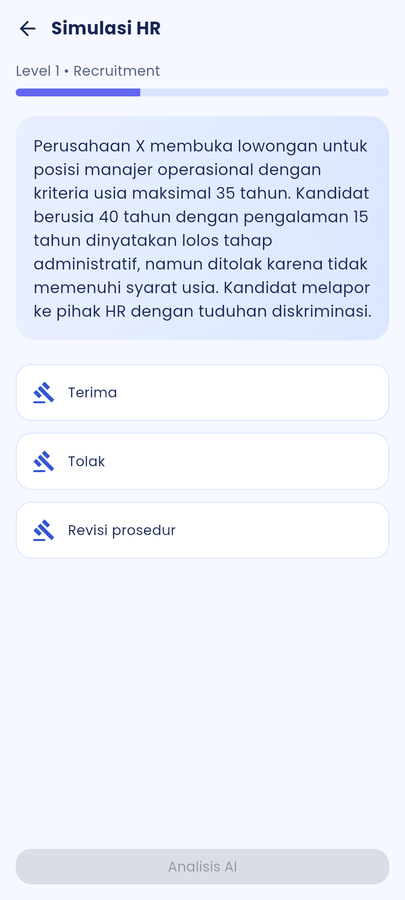
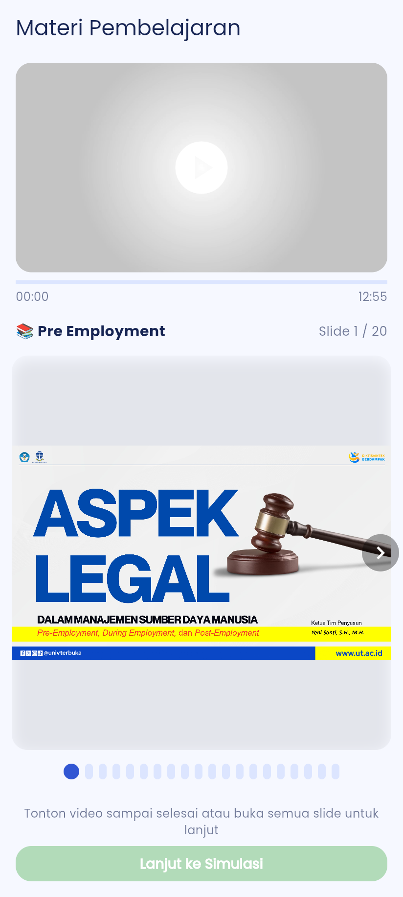
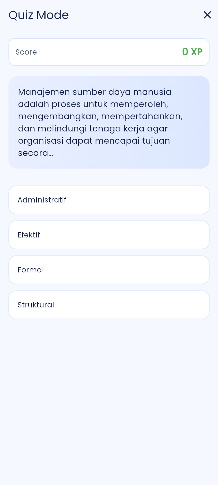
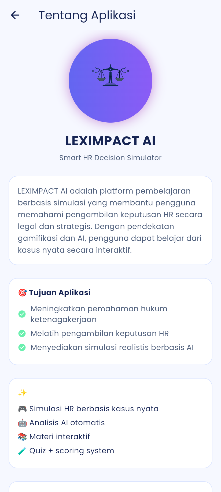

# 🌐 LEXIMPACT AI

> **Legal Experience for HR Decision Impact**
> Aplikasi pembelajaran berbasis **AI + Gamifikasi** untuk memahami pengambilan keputusan HR secara legal dan strategis, dengan fokus pada **hukum ketenagakerjaan Indonesia**.


-6366F1)

---

## 📱 Screenshot

| Home | Simulasi | Materi | Kuis | Tentang |
| :--: | :------: | :----: | :--: | :-----: |
|  |  |  |  |  |

---

## ✨ Fitur Utama

### 🎯 1. Simulasi HR Interaktif (3 Level)

Mengikuti siklus kerja **pre employment → during employment → post employment**:

| Level | Tahap | Contoh Kasus | Cara Bermain |
| ----- | ----- | ------------ | ------------ |
| 1 | Pre-Employment | Diskriminasi usia, pekerja anak, TKA, PKWT, outsourcing | Pilih **Terima / Tolak / Revisi prosedur** |
| 2 | During Employment | Lembur, upah minimum, K3, cuti melahirkan, serikat pekerja, BPJS | Pilih 1 dari 3 kebijakan |
| 3 | Post-Employment | PHK efisiensi, SP1-SP3, mangkir, resign, pensiun | Susun langkah sesuai regulasi |

Kasus diambil dari **bank kasus lokal** (`assets/data/kasus.json`), lalu narasinya ditulis ulang oleh **Google Gemini** agar tiap pemain mendapat cerita berbeda. Fakta kunci, kunci jawaban, dan pasal acuan tetap dari data lokal.

### 📊 2. Penilaian Deterministik

Penilaian **tidak** ditentukan AI, melainkan oleh `RuleEngine` berdasarkan kunci di bank kasus:

- **Level 1 & 2:** setiap pilihan punya skor (mis. 100 / 60 / 0) dan penjelasan.
- **Level 3:** skor parsial = 40% langkah di posisi tepat + 60% urutan relatif antarlangkah.
- Status: **BENAR** (100), **KURANG TEPAT** (≥ 40), **SALAH** (< 40).
- Skor rata-rata ditampilkan di akhir simulasi.

### 🧠 3. RAG Lokal (tanpa database)

- Teks asli 571 pasal dari 10 PDF peraturan ketenagakerjaan disimpan di HP (`assets/data/regulasi.json`).
- Pencarian dengan **BM25** + kamus sinonim istilah hukum (mis. *pemutusan hubungan kerja* ↔ *PHK*, *alih daya* ↔ *outsourcing*).
- Pasal acuan dari kasus selalu disertakan, ditambah hasil pencarian yang relevan.
- **Dasar Hukum** di halaman feedback diambil langsung dari data lokal, jadi pasalnya tidak bisa dikarang AI.
- Gemini hanya menulis **Alasan** dan **Saran** dengan merujuk pasal yang diberikan.
- Jika Gemini gagal atau tidak ada internet, aplikasi tetap jalan memakai narasi dan penjelasan lokal.

### 📚 4. Materi & Kuis

- Materi berupa slide (gambar dari PPT), tersedia offline
- Video pembelajaran lokal
- Kuis dengan sistem skor

---

## 🧱 Arsitektur

```text
┌──────────────────────────────┐
│  Flutter UI (SimulationPage) │
└──────────────┬───────────────┘
               ↓
┌──────────────────────────────┐     ┌──────────────────────────┐
│  SimulationAIService         │ ──▶ │ Google Gemini               │
│  • pilih kasus dari bank     │     │ • tulis ulang skenario   │
│  • susun feedback            │     │ • tulis alasan & saran   │
└──────┬─────────────┬─────────┘     └──────────────────────────┘
       ↓             ↓
┌─────────────┐ ┌──────────────────┐
│ RuleEngine  │ │ RagService (BM25)│
│ skor & status│ │ cari pasal lokal │
└──────┬──────┘ └────────┬─────────┘
       └────────┬────────┘
                ↓
┌──────────────────────────────┐
│ KnowledgeBase (assets/data)  │
│ • regulasi.json  • kasus.json│
└──────────────────────────────┘
```

---

## 📂 Struktur Proyek

```text
lib/
├── main.dart                 # Entry point & ProviderScope
├── app.dart                  # Routing (GoRouter) & tema
├── core/
│   ├── color/                # Palet warna
│   └── theme/                # AppTheme
├── data/
│   ├── datasource/           # Remote datasource & repository impl
│   └── models/               # CaseModel, DecisionModel
└── domain/
    ├── entities/             # CaseEntity, DecisionEntity
    ├── model/                # GeneratedCase, CaseBlueprint, LegalDocument
    ├── repositories/         # Kontrak repository
    ├── service/              # KnowledgeBase, RagService, RuleEngine, GeminiService, SimulationAIService
    ├── usecases/             # GenerateCase, EvaluateDecision
    └── presentation/
        ├── pages/            # Home, Simulation, Materi, Quiz, Result, About, Feedback
        ├── providers/        # Riverpod providers
        └── widgets/          # GameButton, GlassCard

dataset/regulasi/             # PDF peraturan (sumber data hukum)
tools/build_regulasi.py       # PDF → assets/data/regulasi.json

assets/
├── data/                     # regulasi.json (pasal dari PDF) & kasus.json (bank kasus)
├── logo/                     # Logo & ikon aplikasi
├── lottie/                   # Animasi chatbot
├── ppt/                      # Slide materi
└── video/                    # Video pembelajaran
```

### Rute Aplikasi

| Path | Halaman |
| ---- | ------- |
| `/` | Home |
| `/simulation` | Simulasi HR |
| `/materi` | Materi |
| `/quiz` | Kuis |
| `/about` | Tentang |

---

## 🛠️ Tech Stack

| Teknologi | Digunakan untuk |
| --------- | --------------- |
| Flutter & Dart | Aplikasi mobile |
| flutter_riverpod | State management |
| go_router | Navigasi |
| Google Gemini | Narasi kasus & penjelasan feedback (`gemini-3.5-flash`) |
| RAG lokal (BM25) | Pencarian pasal di HP |
| flutter_markdown | Render respons AI |
| flutter_animate, lottie | Animasi UI |
| video_player, just_audio | Media pembelajaran |
| google_fonts | Tipografi |

---

## 🚀 Cara Menjalankan

### Prasyarat

- Flutter SDK (Dart `^3.10.0`)
- Android Studio / Xcode, atau perangkat fisik
- API key [Google Gemini](https://aistudio.google.com/apikey)

### Langkah

```bash
git clone https://github.com/Ramzisyuhada/LeximpactAI.git
cd LeximpactAI
flutter pub get
flutter run --dart-define-from-file=secrets.json
```

### Build APK

```bash
flutter build apk --release --dart-define-from-file=secrets.json
```

### Generate Ikon Aplikasi

```bash
dart run flutter_launcher_icons
```

---

## 🔐 Konfigurasi

### Google Gemini — `lib/domain/service/gemini_service.dart`

API key tidak ditulis di kode. Buat file `secrets.json` di root proyek (sudah diabaikan git):

```json
{ "GEMINI_API_KEY": "API_KEY_ANDA" }
```

Lalu jalankan atau build dengan `--dart-define-from-file=secrets.json`. Tanpa key, simulasi tetap berjalan memakai narasi dan penjelasan bawaan.

### Data Hukum dari PDF Peraturan

Data hukum diambil langsung dari **PDF peraturan** di `dataset/regulasi/` (sumber: JDIH BPK), sesuai daftar di konsep aplikasi:

| File | Peraturan |
| ---- | --------- |
| `uu13-2003.pdf` | UU 13/2003 tentang Ketenagakerjaan |
| `uu21-2000.pdf` | UU 21/2000 tentang Serikat Pekerja/Serikat Buruh |
| `uu1-1970.pdf` | UU 1/1970 tentang Keselamatan Kerja |
| `uu3-1992.pdf` | UU 3/1992 tentang Jaminan Sosial Tenaga Kerja |
| `uu40-2004.pdf` | UU 40/2004 tentang Sistem Jaminan Sosial Nasional |
| `uu2-2004.pdf` | UU 2/2004 tentang Penyelesaian Perselisihan Hubungan Industrial |
| `uu11-1992.pdf` | UU 11/1992 tentang Dana Pensiun |
| `keppres4-1980.pdf` | Keppres 4/1980 tentang Wajib Lapor Lowongan Pekerjaan |
| `kepmen235-2003.pdf` | Kepmenakertrans KEP-235/MEN/2003 (pekerjaan yang membahayakan anak) |
| `kepmen49-2004.pdf` | Kepmenakertrans KEP-49/MEN/IV/2004 (struktur dan skala upah) |

> Kepmenakertrans No. 157 Tahun 2003 belum tersedia dan belum dimasukkan.

Script `tools/build_regulasi.py` memotong PDF menjadi **satu entri per pasal** (teks asli + penjelasan pasal + lampiran) di `assets/data/regulasi.json`. Judul BAB/Bagian/Paragraf dipakai sebagai topik pencarian, dan pasal yang diubah/dihapus UU 6/2023 (Cipta Kerja) diberi `catatan`. Setelah menambah atau mengganti PDF, bangun ulang datanya:

```bash
pip install pypdf fonttools
python tools/build_regulasi.py
flutter test
```

Untuk PDF baru, tambahkan entrinya di daftar `DOCS` dalam script.

### Bank Kasus

`assets/data/kasus.json` berisi blueprint kasus (`level`, `skenario`, `fakta`, `pertanyaan`, `pilihan` + `skor` + `penjelasan`, atau `langkah` berurutan untuk Level 3, serta `refs` ke id pasal seperti `uu13-2003-p78`). `flutter test` memeriksa bahwa semua `refs` ada di data regulasi dan setiap kasus pilihan punya tepat satu jawaban bernilai 100.

---

## 🧠 Contoh Output AI

```text
✅ JAWABAN BENAR · Skor 100/100

## Alasan
- Syarat usia maksimal tidak berkaitan dengan kebutuhan jabatan, sehingga menolak pelamar berkompeten karena usia merupakan diskriminasi [1].

## Dasar Hukum
- UU No. 13 Tahun 2003 Pasal 5 — Kesempatan kerja tanpa diskriminasi: ...
- UU No. 13 Tahun 2003 Pasal 32 — Asas penempatan tenaga kerja: ...

## Saran
- Hapus syarat usia dari iklan lowongan.
- Putuskan berdasarkan hasil tes kompetensi.
```

---

## 📖 Dokumentasi

Panduan penggunaan aplikasi tersedia di:

- [docs/PANDUAN_PENGGUNAAN_LEXIMPACT_AI.pdf](docs/PANDUAN_PENGGUNAAN_LEXIMPACT_AI.pdf)
- [docs/PANDUAN_PENGGUNAAN_LEXIMPACT_AI.html](docs/PANDUAN_PENGGUNAAN_LEXIMPACT_AI.html)
- [Panduan_Penggunaan_Aplikasi_LexImpact_AI.docx](Panduan_Penggunaan_Aplikasi_LexImpact_AI.docx)

---

## 📌 Roadmap

- [x] Simulasi 3 level berbasis AI
- [x] RAG lokal (BM25) + bank kasus offline
- [x] Penilaian deterministik dengan skor parsial
- [x] Materi & kuis
- [ ] Sistem skor & XP
- [ ] Leaderboard
- [ ] Penyimpanan progress user
- [ ] Multi-language
- [ ] Cloud sync

---

## 👨‍💻 Developer

**Ramzi Syuhada**
Flutter Developer | AR/VR Engineer

GitHub: [@Ramzisyuhada](https://github.com/Ramzisyuhada)
